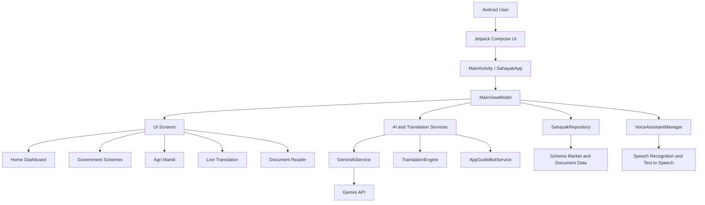

<div align="center">
  <h1>SAHAYAK AI</h1>
  <p><strong>Marathi-First AI & Voice Assistant for Inclusive Digital Access</strong></p>
  <p>Android application built with Kotlin and Jetpack Compose</p>
</div>

---

## Overview

**Sahayak AI** is an Android application designed to make digital public services easier to understand and use for Marathi-speaking citizens. It combines voice interaction, regional Marathi dialect support, speech translation, government welfare scheme information, agricultural market information, and document explanations in one mobile interface.

The app supports regional Marathi dialects such as Varhadi, Ahirani, Malvani, Marathwadi, Zadi Boli, and Minglish.

## Key Features

- **Voice Assistant & Navigation** – Voice-based interaction and app navigation.
- **Regional Dialect Support** – Support for multiple Marathi regional dialects.
- **Live Speech Translation** – Conversation translation between Marathi, English, Hindi, and other languages.
- **Government Welfare Schemes** – Scheme information, eligibility, required documents, and voice assistance.
- **Agriculture & Mandi Information** – APMC market entries, crop information, and pest/remedy guidance.
- **Document Reader** – Document information and Marathi audio explanations for 7/12 records, ration cards, and pension orders.
- **Accessibility Controls** – Large fonts, screen read-aloud, and voice speed controls.
- **App Guide** – In-app guidance for navigating application features.

## Technology Stack

| Area | Technology |
|---|---|
| Platform | Android |
| Language | Kotlin |
| UI | Jetpack Compose |
| Design | Material 3 |
| Architecture | MVVM |
| State Management | Kotlin StateFlow |
| Asynchronous Programming | Kotlin Coroutines and Flow |
| AI Integration | Firebase AI / Gemini API |
| Networking | Retrofit and OkHttp |
| JSON | Moshi |
| Database Dependencies | AndroidX Room |
| Build System | Gradle Kotlin DSL |
| Testing | JUnit, Espresso, Robolectric |

## Application Architecture



### Main Architecture Layers

1. **Presentation Layer** – Displays application screens using Jetpack Compose.
2. **ViewModel Layer** – Manages application state, navigation, and user interactions.
3. **Repository Layer** – Handles scheme, agriculture, and document data.
4. **AI Integration Layer** – Provides AI-powered queries, translation, and application guidance.
5. **Audio Layer** – Handles speech recognition and text-to-speech functionality.

## Project Structure

```text
.
├── app/
│   ├── src/
│   │   ├── main/
│   │   │   ├── java/com/example/
│   │   │   │   ├── MainActivity.kt
│   │   │   │   ├── audio/
│   │   │   │   │   └── VoiceAssistantManager.kt
│   │   │   │   ├── data/
│   │   │   │   │   ├── ai/
│   │   │   │   │   │   ├── AppGuideBotService.kt
│   │   │   │   │   │   ├── GeminiAiService.kt
│   │   │   │   │   │   └── TranslationEngine.kt
│   │   │   │   ├── model/
│   │   │   │   │   └── Models.kt
│   │   │   │   └── repository/
│   │   │   │       └── SahayakRepository.kt
│   │   │   └── ui/
│   │   │       ├── MainViewModel.kt
│   │   │       ├── components/
│   │   │       ├── screens/
│   │   │       └── theme/
│   │   ├── res/
│   │   └── AndroidManifest.xml
│   └── build.gradle.kts
├── gradle/
│   └── libs.versions.toml
├── build.gradle.kts
├── gradle.properties
├── settings.gradle.kts
└── README.md
```

## Getting Started

### Prerequisites

- Android Studio
- Kotlin
- JDK 17 or compatible JDK
- Android SDK
- Android device or emulator
- Internet connection for online AI functionality

### Installation

1. Clone the repository:

```bash
git clone YOUR_GITHUB_REPOSITORY_URL
```

2. Open the project in Android Studio.
3. Wait for Gradle synchronization.
4. Configure the required API keys.
5. Connect an Android device or start an emulator.
6. Click the Run button.

## Gemini API Configuration

The project uses a Gemini API key for AI-powered functionality.

Create a `.env` file in the project root and add:

```properties
GEMINI_API_KEY=YOUR_GEMINI_API_KEY
```

**Important:** Never upload your actual API key or private credentials to GitHub.

## Firebase Configuration

If required by your Firebase integration:

1. Open Firebase Console.
2. Create or select a Firebase project.
3. Register your Android application.
4. Use the application ID:

```text
com.aistudio.sahayak.marathiai
```

5. Download `google-services.json`.
6. Place it inside the `app/` directory.

## Permissions

The application uses the following Android permissions:

- INTERNET
- RECORD_AUDIO
- CAMERA
- ACCESS_NETWORK_STATE
- VIBRATE

## Build and Run

Open the project in Android Studio.

Select:

**Build → Make Project**

To build using Gradle:

```bash
gradle assembleDebug
```

To run tests:

```bash
gradle test
```

## Testing

The project contains testing directories:

```text
app/src/test/
app/src/androidTest/
```

Testing technologies include:

- JUnit
- AndroidX Test
- Espresso
- Robolectric
- Compose UI Testing

## Notes and Limitations

- Some market, scheme, and document information is sample/static data.
- Gemini-backed functionality requires a valid API key and internet connection.
- Translation includes local fallback logic.
- The document reader includes sample-document information and a camera-style interface; a complete OCR pipeline is not established by the current source.
- Microphone and camera features require device permissions.

## Future Enhancements

- Improve Marathi regional dialect recognition.
- Expand government scheme information.
- Integrate verified live agricultural market data.
- Improve document scanning and OCR capabilities.
- Enhance offline voice assistance.
- Expand multilingual support.

## Contributing

Contributions are welcome!

1. Fork the repository.
2. Create a new branch.
3. Make your changes.
4. Commit your changes.
5. Push your branch.
6. Submit a Pull Request.

## License

No license file was included in the uploaded project. Add an appropriate LICENSE file before distributing this project as open source.

---

<div align="center">
  <h3>Sahayak AI</h3>
  <p>Making digital services more accessible through Marathi voice technology.</p>
</div>
